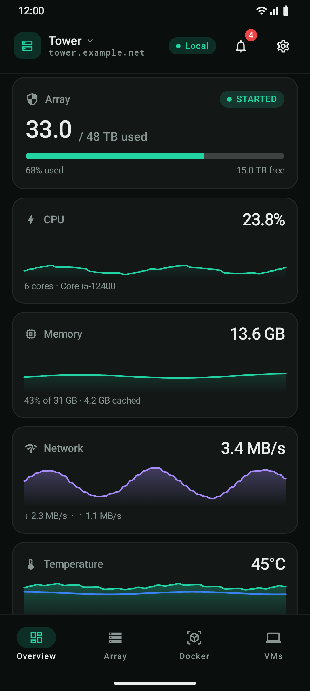
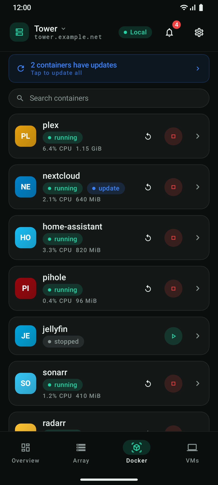
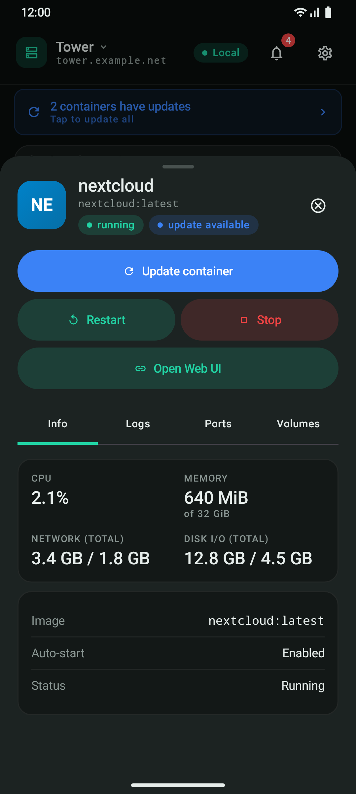

<div align="center">

# NOVA — NAS Operations Viewer Anywhere

**NOVA for Unraid® — your NAS in your pocket. A fast, native Android app for keeping an eye on — and a hand on — your Unraid® server.**

[](https://hellwand.github.io/nova/)

_Screenshots, install options and the privacy summary on the project website._

[](https://github.com/hellwand/nova/releases/latest)
[](https://github.com/hellwand/nova/releases)
[](https://github.com/hellwand/nova/releases)

[](https://github.com/hellwand/nova/releases)
[](https://github.com/hellwand/nova/releases)
[](https://kotlinlang.org)

[](https://github.com/hellwand/nova/actions/workflows/ci.yml)
[](https://github.com/hellwand/nova/security/code-scanning)
[](./LICENSE)

[](renovate.json)
[](https://github.com/hellwand/nova/network/members)
[](https://github.com/hellwand/nova/issues)

</div>

---

NOVA puts the parts of your Unraid® server you actually check on your phone — array health, container and VM state, live system metrics — into a clean, dark, one-thumb interface. Start a container, fix a stuck VM, kick off an update, glance at parity progress: without opening a laptop or fighting the desktop web UI on a phone screen.

It talks to your server through the official Unraid API (the Connect plugin's GraphQL endpoint) over your own network — NOVA itself routes nothing through a third party.

## Screenshots

**Project website:** <https://hellwand.github.io/nova/> — screenshots, install options and a summary of the privacy policy.

<div align="center">

| Overview | Docker | Container detail |
|:---:|:---:|:---:|
|  |  |  |

</div>

## What you can do

- **Overview** — array capacity, CPU & memory live, container/VM counts, parity-check progress at a glance
- **Array** — disk-by-disk status, temperatures, capacity, start/stop the array
- **Docker** — every container with status; start / stop / restart / pause, jump straight to a container's Web UI, see which have image updates and update one — or all — in a tap
- **VMs** — VM state with start / stop / pause / resume
- **Multiple servers** — switch between them; each remembers its own local and remote address
- **Alerts outside the app** — optional, off by default: NOVA checks your servers in the background and notifies you of new Unraid alerts and warnings and of an array that is not started or is degraded ([details](#alerts-outside-the-app))
- **Live network speed** — upload/download on the Overview card (needs Unraid API 4.35.0 or newer); the NIC inventory sits under Settings → Network interfaces (vendor, model and link speed only with a third-party API plugin)
- **Stay current** — the GitHub APK checks GitHub for new releases and shows a notice on the Overview; **Download** lets your browser fetch the file, and you open it to install (NOVA does not install updates itself; the F-Droid build is updated by F-Droid)

## What's not in yet

NOVA surfaces what Unraid's GraphQL API exposes today. A few things commonly asked for aren't there yet — most because the upstream API hasn't added them:

- **Plugin updates** — NOVA shows installed plugins and the install-job history, but Unraid's API doesn't expose "update available" status the way it does for Docker containers. Tracking: [unraid/api#2012](https://github.com/unraid/api/issues/2012).
- **User shares / SMB / NFS**, **UPS**, **disk SMART**, **parity-check scheduling** — not yet surfaced.

If something on this list (or off it) matters to you, an issue or a 👍 on an existing one is the best signal.

## Alerts outside the app

NOVA can tell you about a problem on your server without you opening the app. It is **off by default**: with the switch off NOVA does nothing in the background. You switch it on under **Settings → Notifications → Alerts from your servers**.

**What is checked.** For each of your servers, NOVA asks for its unread Unraid notifications and for the state of its array, and notifies you of:

- every **new** unread Unraid notification of importance alert or warning (once per notification, never twice; "Alerts only" leaves out warnings);
- an array that **is not started**, and an array that **is degraded**. Unraid itself does not notify about these.

Disk temperatures, disk errors, SMART warnings, parity checks and pools reach you through Unraid's own notifications, so they appear as the first kind. The first check after you switch on only notes what is already there and shows nothing. A server that cannot be reached is never an alert; the Settings section lists each server's last check instead. Unraid raises one warning each time a parity check starts, so you will see that one with "Alerts and warnings".

**How often.** Every 30 minutes by default; you can pick 15 minutes, 1 hour or 3 hours, and "Only on Wi-Fi". Android decides the exact time and may batch checks with other apps' work, so an alert can come late, sometimes by an hour or more while the phone lies still (Doze). On Android 13 and later an app you have not opened for 8 days is limited to about one check a day.

**What it needs.**

- Notifications allowed for NOVA. On Android 13 and later NOVA asks when you switch the alerts on; if you refuse, the alerts stay off.
- An **https address** for the server. **A plain-http address is never contacted in the background**, because nobody is looking at the phone and the API key would travel in clear text. A server that has only an http address is not checked, and Settings says "not checked in the background because the connection is not encrypted". The certificate must be one your phone trusts, or the one you pinned for the local address; a changed or untrusted certificate is reported in Settings and never accepted without you. Redirects are not followed in the background.
- An API key that can read notifications and the array: a key with the VIEWER role is enough (from the Unraid API's source code; we have not yet tried the background check with such a key on a real server). Nothing is ever changed on the server.
- Unraid must keep the notification as unread, which it does by default ("Browser" delivery on). If you turned that off for an importance, those notifications do not reach NOVA.

**What it never does.** No Google services, no push service or relay run by this project, no server plugin, no foreground service, no exact alarms, no request to ignore battery optimisation. The checks go only to your own servers. The demo server is never checked. Switching the alerts off cancels the work and removes what NOVA posted.

**Phones that stop background work.** Some makers (Huawei, Xiaomi, Samsung and others) stop apps in the background more strictly than Android does, and the checks may then not run at all. Settings has a link to [dontkillmyapp.com](https://dontkillmyapp.com) (opened by your browser, only when you tap it) and, when Android restricts the app, a shortcut to the battery settings. On EMUI, for example, you need Battery → App launch → NOVA → Manage manually. Whether a check ran is visible in the "Last check" lines in Settings.

**Instant alerts with Unraid's own agents.** If you want alerts the moment they happen, let Unraid send them itself. For example, with the ntfy agent (from Unraid's source, not tried by this project): Settings → Notifications in the Unraid web UI → the ntfy.sh agent with your own ntfy server and a topic → tick "Agents" for warnings and alerts → subscribe to the topic in the ntfy app. The agent adds an icon link to every message, and that image is hosted on GitHub. This needs no NOVA setting.

## Look & feel

A deliberately dark, glassy Material 3 design — dense cards, a single accent color, restrained motion. Tuned for quick checks, not for living in.

A few things bend to taste in **Settings**:

- **Accent** — mint, blue, purple, amber or red
- **Mode** — dark, light or follow the system
- **Density** — compact, balanced or spacious padding
- **Docker layout** — list, grid or grouped-by-state

## Getting started

1. **Install** NOVA — either from [F-Droid](https://f-droid.org/packages/io.github.nofuturekid.nova/) (stable releases only) or as the latest APK from the [Releases page](https://github.com/hellwand/nova/releases). (For the APK, Android will ask you to allow installing from your browser/files app — that's expected for apps outside the Play Store.)
   - Betas are GitHub pre-releases, so they come as an APK from the Releases page. NOVA tells you when a new version is out (switch on **Include pre-releases** in Settings for betas) and sends your browser to the APK; Obtainium works too.
   - The F-Droid build and the GitHub APK are signed with different keys, so switching between them needs an uninstall first (your saved servers and API keys go with the app). See [ADR-0040](./docs/adr/0040-fdroid-play-distribution-flavors.md).
2. On your Unraid server, generate an **API key**: web UI → _Settings → Management Access → API / Connect_ (which rights it needs: [API key permissions](#api-key-permissions)).
3. Open the app → **Add server** and fill in:
   - **Server name** — a label, e.g. `Tower`
   - **Local host** — its address on your home network, e.g. `192.168.1.10`. Flip **Use SSL (HTTPS)** if the server uses HTTPS; for a self-signed certificate also enable **Trust self-signed certificate** and confirm it once. If your server's _Use SSL/TLS_ setting is _Yes_ or _Strict_, it answers a plain `http` request with a redirect to `https`; NOVA does not follow redirects (the API key would travel with it), so enter the address it names, with **Use SSL (HTTPS)** on. A tab or **Test** shows it as "The server redirects to …"
   - **Remote host (Unraid Connect)** — optional, e.g. `your-server.unraid.net`, for when you're away (with its own **Use SSL (HTTPS)** switch)
   - **API Key** — the one you just generated
4. Tap **Test** (next to the local and/or remote connection), then **Save**. The pill in the top bar flips between **Local** and **Remote**.

### Google Play Protect

**Versions up to 0.1.46 (GitHub APK).** On 2026-11-13 we observed that Google Play Protect stopped every GitHub build we tried (0.1.45-beta1, 0.1.45 and 0.1.46-beta1) when it was installed or updated, on a phone with Android 9 and on one with Android 17. Two dialogs appear one after the other:

1. **"App scan recommended"** (German: "App-Scan empfohlen") — Play Protect does not know the file yet. Android shows this for every new file that is not from Google Play. Tap **Scan app** ("App scannen").
2. **"Harmful app blocked"** (German: "Schädliche App blockiert"), "This app may be harmful" ("Diese App könnte schädlich sein."). You can continue through **More details > Install anyway** ("Weitere Details > Trotzdem installieren").

This is Google's rating of the file, not a finding about what NOVA does; Google does not say why it gives it. Our observation, which Google has not confirmed: these builds could install other apps (that is how the old in-app updater worked), and a build of the same version without that ability was rated "This app seems safe" ("Diese App ist anscheinend sicher") by the same scan on the same phone. NOVA is open source (GPL v3), and you can check what you installed:

- **SHA-256 of the file:** the release page lists it next to the APK; compare it with `sha256sum NOVA-v….apk`.
- **Signing certificate:** `apksigner verify --print-certs NOVA-v….apk` should show the SHA-256 digest `9f86baa17c1208004d9284e99597f77276c77301b06340b10075c793152b6824`.

**From version 0.1.47 on**, NOVA no longer installs updates itself and no longer asks for the permission to install apps. **Download** in the update sheet lets your browser download the file; you open it to install. Android will still ask once to scan each new file ("App scan recommended"), because Play Protect does not know it yet; that is expected. We cannot promise that no warning appears, since Google's rating can change.

**F-Droid** is the channel without any such prompt we have seen, but it has stable releases only, gets updates later, and is signed with a different key. Switching between the GitHub APK and F-Droid means uninstalling first, which removes your saved servers and API keys.

Requires an Unraid 7.x server with the API/Connect plugin enabled. All app features need Unraid API **4.30.0 or newer**; the live network speed needs **4.35.0 or newer** (API versions, not Unraid OS versions). On an older API some screens fail to load.

## API key permissions

NOVA talks to your server with one API key per server. **NOVA never needs the ADMIN role or any permission to manage API keys.** Pick whichever of these suits you:

- **Simplest, read-only: a key with the VIEWER role.** It can see everything NOVA shows and cannot change anything, except that servers older than Unraid API 4.37.4 let every key archive and delete notifications [^4]. NOVA hides the buttons that need more rights.
- **Simplest, full control: a key with the ADMIN role.** It can do everything NOVA offers. It can also do much more, which NOVA never uses.
- **Least privilege: the VIEWER role plus only the controls you want.** See the table below.

### What each feature needs

A permission is written as `RESOURCE:ACTION`, for example `DOCKER:UPDATE_ANY`. The action must match exactly: `UPDATE_ANY` does not include `READ_ANY`, and the `_OWN` actions never count. The last column says how well a row is established: **Live** means we ran it against a real server with a key that holds the permission; **Refusal live** means we saw a key without the permission refused, while that the named permission is enough comes from the Unraid API's source code; **Source** means only from the source code (see the notes below the table).

| NOVA feature                                                                                         | A key needs                                                                                   | Established       |
| ---------------------------------------------------------------------------------------------------- | --------------------------------------------------------------------------------------------- | ----------------- |
| See everything (Overview, metrics, network, array, containers and logs, VMs, notifications, plugins) | Role **VIEWER**                                                                               | Live [^1]         |
| Start, stop, restart, pause, resume and update one container                                         | `DOCKER:UPDATE_ANY`, on top of VIEWER                                                         | Live [^3]         |
| Update all containers                                                                                | `DOCKER:UPDATE_ANY`                                                                           | Source [^6]       |
| Start, stop, pause, resume, reboot, reset and force-stop VMs                                         | `VMS:UPDATE_ANY`                                                                              | Refusal live [^7] |
| Start or stop the array; start, pause, resume or cancel a parity check                               | `ARRAY:UPDATE_ANY`                                                                            | Source [^6]       |
| Archive, mark as unread, archive all notifications                                                   | `NOTIFICATIONS:UPDATE_ANY`                                                                    | Refusal live [^4] |
| Delete a notification, delete all archived                                                           | `NOTIFICATIONS:DELETE_ANY`                                                                    | Refusal live [^4] |
| Never needed                                                                                         | The ADMIN role, any `API_KEY` or `PERMISSION` permission, any `CREATE_ANY` permission         | Source            |

A least-privilege key is the VIEWER role plus the explicit permissions for the actions you want, for example `DOCKER:UPDATE_ANY`, `VMS:UPDATE_ANY`, `ARRAY:UPDATE_ANY`, `NOTIFICATIONS:UPDATE_ANY` and `NOTIFICATIONS:DELETE_ANY` for full control. Leave out the ones for things you do not want NOVA to do. The server reports a key's effective rights as the role's rights plus its explicit permissions (confirmed live for VIEWER plus `DOCKER:UPDATE_ANY`). Only the container part of this recipe was tried with such a key.

Do not build a key from read permissions only. The server's command line tool cannot create a key without a role (it requires one), and we did not check whether the web interface can. As background, from the server's source and not verified with such a key: reading everything without the VIEWER role would need `READ_ANY` on `INFO`, `DISPLAY`, `ARRAY`, `DOCKER`, `VMS`, `NOTIFICATIONS`, `CONFIG` and `ME`.

[^1]: Checked on 2026-11-13 against a server running Unraid 7.4.0 with Unraid API 4.37.11: a key with only the VIEWER role got HTTP 200 with data on every screen's query; the logs query was checked only as far as the permission (it was sent with an unknown container id).

[^3]: Checked live on the same server: a VIEWER key was refused when it started, stopped, paused, unpaused or updated a container, and a VIEWER key with `DOCKER:UPDATE_ANY` got past the permission check (tried with an id that does not exist, so nothing could change). On Unraid API 4.36.0 and newer NOVA restarts a container with the server's own one-step restart, and as a stop followed by a start on older servers or when the version is not known, so a restart needs the same `DOCKER:UPDATE_ANY` either way.

[^4]: Servers before API 4.37.4 do not check these two permissions at all (read from the source of 4.37.3 and 4.37.4), so every key can archive and delete notifications there. On 4.37.11 the refusal of a VIEWER key was seen live for archive, mark as unread and delete.

[^6]: Not testable without acting on a server (they have no id that could be faked), so this row is from the source code at 4.37.11 only.

[^7]: Live: a key without `VMS:UPDATE_ANY` is refused on VM start and stop. Not tried with a key that holds it, and not every VM action was probed.

### Where to set the key and its permissions

In the Unraid web interface open _Settings → Management Access → API_ (Unraid's documentation lists the keys under _Management Access_, as _API Keys_). When you create a key you choose its role and, if you want, individual permissions. The upstream form offers both ([source](https://github.com/unraid/api/blob/v4.37.11/web/src/components/ApiKey/ApiKeyCreate.vue)); we have not looked at how the dialog is laid out on every Unraid version. The same can be done on the server's command line, following Unraid's [API key documentation](https://docs.unraid.net/API/programmatic-api-key-management/), which also recommends specific permissions over the ADMIN role:

```sh
unraid-api apikey --create --name "NOVA" --roles VIEWER \
  --permissions "DOCKER:UPDATE_ANY,VMS:UPDATE_ANY,ARRAY:UPDATE_ANY,NOTIFICATIONS:UPDATE_ANY,NOTIFICATIONS:DELETE_ANY"
```

The command shape, with the VIEWER role and `DOCKER:UPDATE_ANY`, was run live and works; the other permissions in the example were not tried. If you change a key's permissions later, the key itself stays the same, so you do not need to enter it again in NOVA.

### When a permission is missing

The server decides, not NOVA. An action the key may not do is refused with the message **"Forbidden resource"** and nothing changes on the server (confirmed live for container actions with a VIEWER key). A read the key may not do is refused the same way, so that screen fails to load. A key the server does not accept at all is answered with "API key validation failed". NOVA asks the server what the key may do and hides the controls it cannot use, with one "View only" note in their place that names the permission. If NOVA cannot find that out, it shows the buttons, and a refused action then says which permission is missing.

### Which Unraid API version you need

Every screen needs Unraid API **4.30.0 or newer**; live network speed needs **4.35.0 or newer**. These are versions of the Unraid API, not of Unraid OS. They are different numbers.

To see which API version you have, open _Settings → Management Access → API_ in the web interface, where the installed Unraid API version should be shown [^5]. As a rule of thumb, every Unraid OS release from 7.2.5 on ships an API of 4.30.0 or newer (we checked 7.2.5, 7.2.8, 7.3.0, 7.3.2 and 7.4.0 against the release notes). The reverse does not hold: the API version does not rise steadily with the OS version, for example 7.2.8 ships 4.36.1 and 7.3.2 ships 4.35.1.

[^5]: We have not checked what that page shows on each Unraid version. If you cannot find the version there, Unraid's release notes for your OS version name the API version that ships with it.
## Trademark attribution

Unraid® is a registered trademark of Lime Technology, Inc. NOVA is an independent, community-built client; it uses the term solely to describe compatibility with the Unraid® operating system and is not affiliated with, endorsed by, or supported by Lime Technology. The project was previously named `UnraidControl`; the rename to NOVA in v0.1.33 was made to comply with the Unraid® Trademark Policy — see [ADR-0038](./docs/adr/0038-lime-trademark-compliance-rename-pending.md) and [ADR-0039](./docs/adr/0039-rename-to-nova.md).

## Privacy & data handling

- **Full policy:** <https://github.com/hellwand/nova/blob/main/docs/privacy/POLICY.md>
- **Your API key stays on your device.** It's encrypted at rest using Android Keystore via Google's Tink library, and explicitly excluded from cloud backup / device-transfer.
- **No analytics, no telemetry, no tracking services.** The app talks to your Unraid server's API; in the GitHub (`direct`) build it also asks GitHub's API for app updates (at app start, when the app returns from the background or you come back to the main screen from Settings or the server list, when you open Settings, or on "Check now"); and it loads container icons from the URLs your own server supplies (often GitHub or a CDN).
- **Background checks only if you switch them on.** With "Alerts from your servers" on, NOVA asks your own servers, in the background and over verified https only, for their unread alerts and warnings and their array state, as often as you chose. Nothing else is contacted for it, and with the switch off nothing runs in the background. See [Alerts outside the app](#alerts-outside-the-app).
- **Update downloads** are made by your browser, not by NOVA: the update sheet opens the release's APK on GitHub, shows its SHA-256 so you can compare it with the downloaded file, and the app itself downloads and installs nothing. See [ADR-0046](./docs/adr/0046-update-via-browser-download.md).
- **Source is the spec.** Audit, fork, run yourself — GPL v3.

## Contributing & internals

The architecture overview is in [`HANDOFF.md`](./HANDOFF.md) (Layout), design decisions are recorded as Architecture Decision Records under [`docs/adr/`](./docs/adr/), and the contribution workflow and release pipeline are in [`CONTRIBUTING.md`](./CONTRIBUTING.md). Bug reports and PRs welcome.

Before pushing, you can run the exact CI checks locally in a pinned container with `./scripts/local-ci.sh` — see [`docs/local-build.md`](./docs/local-build.md).

## License

[](./LICENSE)

GNU General Public License v3.0. Use it (including commercially), modify it, run it — but if you distribute the app or a fork, the corresponding source has to be available under the same license. Full text in [`LICENSE`](./LICENSE); rationale in [ADR-0021](./docs/adr/0021-relicense-to-gpl-3.md).

© 2026 nofuturekid
